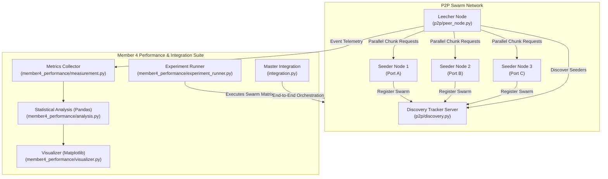

# P2P – Peer-to-Peer File Distribution System

**Course**: CS-30003 · Coding Assignment 1  
**Section**: CSE-14 | **Path**: A (Catalogue Project)  
**Repository**: P2P File Distribution System

---

## Team Members & Work Split

| Member | Name | Roll Number | Responsibilities |
|:------:|:-----|:-----------:|:-----------------|
| **1** | Harsh Priyadarshi | 241551011 | Peer initialization, peer discovery, and TCP socket communication. |
| **2** | Sanket Panda | 2405833 | File metadata management, file splitting, and piece-request logic. |
| **3** | Arnav Raj | 24156006 | Parallel upload/download, piece verification, and failure handling. |
| **4** | **Udbhav Singh** | **241551102** | **Performance measurement, visualization, experiment analysis, integration, and documentation.** |

---

## 1. What We Built

A decentralized **Peer-to-Peer (P2P) File Distribution System** written in Python. Nodes in the network discover each other via a rendezvous tracker, exchange file metadata, chunk files into fixed-size cryptographic pieces (SHA-256), download missing pieces in parallel from multiple peers using a rarest-first piece selection policy, and verify file integrity upon complete reassembly.

### Core Features
- **TCP Socket Wire Protocol**: Custom length-prefixed framing format `[4B Header Len][4B Payload Len][JSON Header][Raw Binary Payload]` ensuring stream boundary preservation.
- **Dynamic Peer Discovery**: Centralized lightweight tracker tracking active swarms and node bitfield states.
- **Cryptographic Chunking**: Deterministic chunk generation and individual SHA-256 piece validation.
- **Rarest-First Piece Selection**: Swarm-wide piece frequency tracking to prevent rare-piece bottlenecks.
- **Concurrent Transfer Engine**: Worker thread pool supporting multi-source simultaneous piece downloads.
- **Fault Recovery**: Churn handling, socket timeouts, piece retry queues, and peer blacklisting.
- **Instrumentation & Visualization (Member 4)**: Microsecond-precision metrics collector, automated benchmark testbed, Pandas statistical analyzer, and 6 publication-ready Matplotlib figures.

---

## 2. Project Architecture



---

## 3. Directory Layout

```
p2p_file_distribution/
├── p2p/
│   ├── __init__.py
│   ├── protocol.py             # Binary framing & message wire protocol (Member 1)
│   ├── discovery.py            # Tracker server & client discovery (Member 1)
│   ├── metadata.py             # SHA-256 hashes, file manifest (Member 2)
│   ├── chunking.py             # File chunking & bitfield storage (Member 2)
│   ├── piece_selector.py       # Rarest-first piece selection (Member 2)
│   ├── verification.py         # Piece & file cryptographic integrity (Member 3)
│   ├── failure_handler.py      # Churn, timeouts & retry queues (Member 3)
│   └── peer_node.py            # Fully integrated peer node daemon
│
├── member4_performance/        # === MEMBER 4 CORE MODULES ===
│   ├── __init__.py
│   ├── measurement.py          # High-precision performance measurement engine
│   ├── experiment_runner.py    # Automated test runner testing claim matrix
│   ├── analysis.py             # Statistical aggregation, speedup & efficiency
│   └── visualizer.py           # Publication-grade Matplotlib plotting pipeline
│
├── integration.py              # Master Integration Orchestrator (Member 4)
├── run_demo.py                 # Live 4-node swarm transfer demonstration
├── run_experiments.py          # Master benchmark runner (generates plots & tables)
├── tests/
│   └── test_integration.py     # Unit and integration test suite
│
├── results/                    # Auto-generated benchmark outputs:
│   ├── raw_metrics.csv
│   ├── raw_metrics.json
│   ├── piece_transfer_logs.csv
│   ├── summary_tables.md
│   └── figures/
│       ├── download_time_vs_peers.png
│       ├── throughput_vs_peers.png
│       ├── speedup_analysis.png
│       ├── piece_distribution.png
│       ├── chunk_size_tradeoff.png
│       └── peer_failure_impact.png
│
└── docs/
    ├── MEMBER_4_DOCUMENTATION.md  # Detailed implementation & API documentation
    ├── EXPERIMENT_REPORT.md        # Comprehensive formal scientific report
    └── VIVA_PREPARATION.md         # Viva Voce questions & answers
```

---

## 4. Quickstart: How to Run

### Step 1: Set up Virtual Environment
```bash
python -m venv venv
# Windows:
venv\Scripts\activate
# Linux/macOS:
source venv/bin/activate

pip install matplotlib pandas
```

### Step 2: Run Unit & Integration Tests
```bash
python tests/test_integration.py
```

### Step 3: Run Live Swarm Demo
Executes a live 8 MB file transfer across 4 parallel seeders and displays load distribution:
```bash
python run_demo.py
```

### Step 4: Run Complete Benchmark Matrix & Generate Figures
Runs the 48-trial parameter matrix, tests chunk size trade-offs, simulates peer crashes, and exports all figures to `results/figures/`:
```bash
python run_experiments.py
```

---

## 5. Member 4 Evaluation Summary

| Deliverable | File Location | Status |
|:------------|:--------------|:------:|
| **Performance Measurement** | `member4_performance/measurement.py` | Complete |
| **Visualization Suite** | `member4_performance/visualizer.py` | Complete (6 Figures) |
| **Experiment Analysis** | `member4_performance/analysis.py` | Complete |
| **Automated Harness** | `member4_performance/experiment_runner.py` | Complete |
| **System Integration** | `integration.py` | Complete (Tested & Verified) |
| **Scientific Report** | `docs/EXPERIMENT_REPORT.md` | Complete |
| **Viva Voce Prep** | `docs/VIVA_PREPARATION.md` | Complete |
| **Member 4 Tech Doc** | `docs/MEMBER_4_DOCUMENTATION.md` | Complete |
