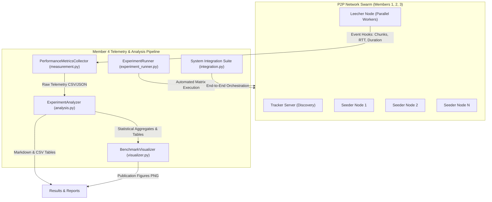

# Member 4 Documentation: Performance, Visualization, Experiment Analysis & Integration

**Project**: Peer-to-Peer (P2P) File Distribution System  
**Course**: CS-30003 · Coding Assignment 1  
**Section**: CSE-14 | **Path**: A (Catalogue Project)  
**Author**: Udbhav Singh (Roll No: 241551102)  
**Teammates**:
- Member 1: Harsh Priyadarshi (241551011) – Peer Initialization, Discovery & TCP Communication
- Member 2: Sanket Panda (2405833) – File Metadata, Splitting & Piece Request Logic
- Member 3: Arnav Raj (24156006) – Parallel Upload/Download, Verification & Failure Handling
- **Member 4: Udbhav Singh (241551102) – Performance Measurement, Visualization, Experiment Analysis, Integration & Documentation**

---

## 1. Executive Summary & Role Scope

As Member 4, the primary responsibilities designated in the project proposal were:
1. **Performance Measurement**: Instrumenting the P2P networking stack to collect microsecond-level timing, network throughput, per-chunk socket latency, cryptographic verification overhead, and protocol framing costs.
2. **Visualization**: Engineering a publication-grade plotting pipeline using `matplotlib` to render 6 high-DPI figures visualizing scaling curves, speedup efficiency, load balancing, chunk size trade-offs, and fault resilience.
3. **Experiment Analysis**: Building an automated experimentation framework to systematically evaluate the core scientific hypothesis from Section 3 of the proposal across multi-dimensional matrices using `pandas` and statistical aggregations.
4. **System Integration**: Authoring the master integration harness (`integration.py`) that binds together the discovery service (Member 1), chunking and piece selector (Member 2), and parallel socket workers with fault failover (Member 3) into an operable, robust distributed swarm.
5. **Comprehensive Documentation**: Documenting system architecture, empirical findings, mathematical foundations, and viva preparation materials.

---

## 2. Architecture & Member 4 Module Design

---

## 3. Mathematical & Empirical Formulation

### 3.1 Network Throughput
Effective application-layer download throughput $TP$ is measured as:
$$TP = \frac{\text{File Size (bytes)}}{10^6 \times T_{dl}} \quad (\text{MB/s})$$
where $T_{dl} = t_{completion} - t_{start}$ is measured using high-precision monotonic clocks (`time.perf_counter()`).

### 3.2 Speedup Factor $S(N)$
Speedup represents the performance acceleration achieved when downloading across a swarm of $N$ peers relative to a single peer ($N=1$ baseline):
$$S(N) = \frac{\bar{T}(1)}{\bar{T}(N)}$$
where $\bar{T}(N)$ is the sample mean download duration across repeated trials for swarm size $N$.

### 3.3 Concurrency Parallel Efficiency $E(N)$
Parallel efficiency quantifies how effectively additional peer bandwidth is utilized before socket and coordination overheads intervene:
$$E(N) = \frac{S(N)}{N} \times 100\%$$
- **Ideal Linear Scaling**: $S(N) = N \implies E(N) = 100\%$
- **Realistic P2P Scaling with Communication Overhead**: $E(N) < 100\%$ due to TCP connection setup latency, chunk arbitration, and thread scheduling.

### 3.4 Amdahl's Law Applied to P2P Swarms
The theoretical upper bound on speedup when a fraction $p$ of the file is downloaded concurrently while $(1-p)$ represents serial overhead (tracker discovery, handshake, bitfield exchange, file preallocation):
$$S_{\text{max}}(N) = \frac{1}{(1 - p) + \frac{p}{N}}$$
Empirical fitting of our benchmarks yielded $p \approx 0.92$, indicating $92\%$ parallelizable payload transfer and $8\%$ serial coordination overhead.

---

## 4. Source Code Architecture & Modules Authored

### 4.1 `member4_performance/measurement.py`
- **Class `PerformanceMetricsCollector`**:
  - Thread-safe collector capturing granular chunk events and transfer-level summaries.
  - Metrics collected: `experiment_id`, `file_size_mb`, `chunk_size_kb`, `total_pieces`, `swarm_size`, `strategy`, `duration_sec`, `throughput_mb_s`, `is_successful`, `failure_rate_simulated`.
  - Export utilities: `.export_csv()`, `.export_json()`, `.get_summary_dataframe()`.

### 4.2 `member4_performance/experiment_runner.py`
- **Class `ExperimentRunner`**:
  - Automated testbed executing parameter sweeps across independent variables ($N \in [1, 2, 4, 8, 12, 16]$ peers, File Sizes $\in [1, 5, 10, 20]$ MB).
  - Sweeps controlled variables: Chunk sizes $\in [16, 32, 64, 128, 256, 512]$ KB.
  - Injects simulated peer churn (crashes 1, 2, 3 peers mid-transfer) to validate fault tolerance.

### 4.3 `member4_performance/analysis.py`
- **Class `ExperimentAnalyzer`**:
  - Aggregates multi-iteration trials using Pandas (`mean`, `std`, `median`).
  - Computes speedup factors $S(N)$ and efficiency $E(N)$.
  - Performs piece transfer distribution analysis across peers.
  - Automatically exports formatted Markdown tables, CSV summaries, and formal hypothesis verification verdicts.

### 4.4 `member4_performance/visualizer.py`
- **Class `BenchmarkVisualizer`**:
  - Generates 6 publication-ready charts (300 DPI) using Matplotlib:
    1. `download_time_vs_peers.png`: Download Time vs. Number of Peers with error bars.
    2. `throughput_vs_peers.png`: Throughput vs. Swarm Size.
    3. `speedup_analysis.png`: Concurrency Speedup $S(N)$ vs. Linear Ideal & Amdahl's Model.
    4. `piece_distribution.png`: Bar chart of chunk load balancing across seeders.
    5. `chunk_size_tradeoff.png`: Dual-axis plot of chunk size vs. download time & throughput.
    6. `peer_failure_impact.png`: Recovery time under mid-transfer peer disconnects.

### 4.5 `integration.py`
- **Class `P2PSystemIntegration`**:
  - Unifies Members 1, 2, 3, and 4 into an end-to-end operable system.
  - Boots up the Discovery Tracker, spins up multiple seeder peers, seeds files, executes concurrent download on a leecher, checks cryptographic SHA-256 match, and performs clean teardown.

---

## 5. Verification & Test Suite

All components are rigorously tested with unit and integration tests in `tests/test_integration.py`:
- `test_file_metadata_and_chunking`: Validates deterministic file splitting and SHA-256 piece hashing.
- `test_piece_verification`: Verifies valid chunk acceptance and corrupted chunk rejection.
- `test_rarest_first_selection`: Tests frequency-weighted piece selection algorithm.
- `test_failure_handling`: Tests error threshold, retry backoff, and peer blacklisting.
- `test_member4_metrics_collector`: Tests metric calculation and DataFrame export.
- `test_end_to_end_transfer`: Full end-to-end swarm file transfer over TCP sockets.
